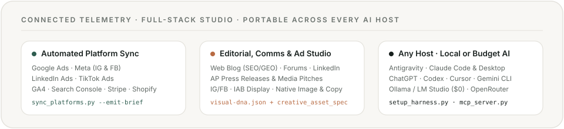
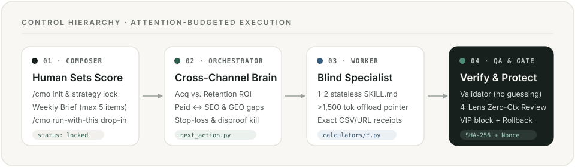

<div align="center">


<br />
<br />

**An attention-budgeted, deterministic AI Marketing & Comms Department for solo founders and lean SMBs.**

Works in **Antigravity** · **Gemini 4 Hydrogen** (`$0` AI Studio Free Tier) · **Claude Code & Desktop** · **ChatGPT** · **Codex** · **Cursor** · **Local Ollama / LM Studio** · **OpenRouter**  
Zero external Python dependencies (`Python 3.11+` stdlib) · Built-in Stdio MCP Server · MIT Licensed

[Quick Start](#quick-start) &nbsp;·&nbsp; [User Journeys](#user-journeys) &nbsp;·&nbsp; [Harness & Local LLM Setup](./docs/HARNESS_SETUP.md) &nbsp;·&nbsp; [Safeguards](#built-in-safeguards) &nbsp;·&nbsp; [25-Skill Library](#25-skill-library)

</div>

---

Most AI marketing tools are noisy prompt dumps that invent metrics and bury you in 50-page docs. **FreeCMO** takes the opposite approach: calm, verifiable execution across ads, search, social, editorial, retention, and comms.

- **Automated telemetry & cash-safe math, zero guesswork** — Pulls read-only performance directly from **Google Ads, Meta (Instagram & Facebook), LinkedIn, TikTok, GA4, Search Console, Stripe, and Shopify** (or offline CSVs) and computes CAC payback, **J-curve working-capital runway**, **logo churn & NRR**, **blended MER**, **ad creative fatigue**, promo break-even, referral `k`-factor, and creator caps in pure Python. Missing numbers stay `unknown`.
- **Strategy before production** — Ads, blog posts, press releases, and code PRs stay hard-blocked until you review and lock `.agents/brand-truth.md`.
- **10 minutes a week** — Synthesizes cross-channel outcomes into **one batched Weekly Composer's Brief (max 5 ranked decisions)**, surfacing Circuit Breaker alerts only when tracking breaks, churn spikes, cash troughs threaten runway, or spend blows up.

<br />

<div align="center">

</div>

---

## User Journeys

<div align="center">

</div>

<br />

<table>
<tr>
<td width="50%" valign="top">

### 01 · Day-1 Setup & Strategy Lock
`/cmo init` · `cmo_runner.py init`

Point FreeCMO at your site URL or repo with your budget and margins. It stages `.agents/brand-truth.md` and `.agents/visual-dna.json`, calculates your **break-even ROAS** and **allowable CAC**, and locks out campaign production until you approve `status: locked`.

</td>
<td width="50%" valign="top">

### 02 · Automated Weekly Monday Brief
`sync_platforms.py --emit-brief`

Automatically pulls Google Ads, Meta/IG/FB Ads & organic insights, LinkedIn, TikTok, GA4, GSC, Stripe, and Shopify (SHA-256 hashing customer emails locally), reconciles **blended MER**, flags fatigued ad hooks, and emits **≤5 P0/P1/P2 decisions** with receipts.

</td>
</tr>
<tr>
<td width="50%" valign="top">

### 03 · Social, Display, Native & Multimodal Critique
`display-native-ad-studio` · `cmo_runner.py --attach`

Guides **AI image generation prompts**, **real photo/UI shot lists**, safe zones, and copy across **Instagram**, **Facebook**, **LinkedIn**, **X**, **IAB Display**, and **Native ads** — plus native **Gemini 4 Hydrogen** multimodal visual critique of ad mockups, PDFs, and landing-page screenshots.

</td>
<td width="50%" valign="top">

### 04 · Editorial Blog, Forum & Comms PR Desk
`editorial-blog-linkedin-writer` · `comms-press-release-writer`

Writes answer-first **SEO/GEO web blog posts** (with `Article` & `FAQPage` JSON-LD), zero-fluff **Reddit/HN/forum posts** (with automatic affiliation disclosure), **LinkedIn articles**, and **AP-style press releases** + journalist pitches strictly separating `[STONE]` facts from `[OPINION]` quotes.

</td>
</tr>
<tr>
<td width="50%" valign="top">

### 05 · Google AI Mode Fan-Out, GEO & Waste Mining
`fanout_audit.py` · `seo-geo-code-pr` · `geo_benchmark.py`

Audits HTML/Markdown pages for **Google Search AI Mode (Gemini 4 Hydrogen) Query Fan-Out** readiness (question headings, 20–80w direct answers, semantic comparison `<table>`s, JSON-LD, AI crawler `robots.txt` access), clusters wasted ad spend (`ngram_waste.py`), and opens isolated schema/comparison PRs.

</td>
<td width="50%" valign="top">

### 06 · Churn, J-Curve Cash Runway, Launches & Referrals
`churn-winback-engine` · `launch-campaign-playbook` · `review-referral-flywheel`

Simulates **12-month J-curve working-capital cash troughs** before scaling upfront CAC, blocks cold paid scaling when monthly churn hits leaky-bucket levels (`>=8%`), guards T-21..T+7 launches with pacing circuit breakers, and models FTC-compliant review velocity + CAC-capped double-sided referral loops (`k`-factor).

</td>
</tr>
</table>

---

## Architecture

<div align="center">

</div>

<br />

Only the **Orchestrator** (`AGENTS.md` + `scripts/next_action.py`) reasons across channels. Specialist skills are stateless and blind to other channels, keeping active context lean (`<=16` active runtime skills per profile, payloads `>1,500` tokens offloaded to `data/offload/`, static-to-dynamic KV-cache ordering, permanent taste memory in `.agents/instincts.md`, and 1-click rollbacks in `data/rollbacks/`).

---

## Run Anywhere: Gemini 4 Hydrogen (`$0`), IDE, Desktop, Web, Local Machine, or OpenRouter

Generate ready-to-use configs for any host in one command (full step-by-step instructions in **[`docs/HARNESS_SETUP.md`](./docs/HARNESS_SETUP.md)**):

```bash
python3 scripts/setup_harness.py --host all
```

| Environment | How FreeCMO Connects |
|---|---|
| **Gemini 4 Hydrogen (`$0` Free Tier)** | Native `gemini-4-hydrogen` execution (`LOW`/`MEDIUM`/`HIGH`/`XHIGH` thinking levels + `--attach` multimodal ad/LP critique) via Google AI Studio API. |
| **Antigravity & Gemini CLI** | Native `GEMINI.md`, `AGENTS.md`, `gemini-extension.json`, and `scripts/mcp_server.py`. |
| **Claude Code & Claude Desktop** | Native `CLAUDE.md`, `.claude-plugin/plugin.json`, and zero-dependency stdio MCP (`freecmo-core`). |
| **ChatGPT & Claude Web Projects** | `setup_harness.py` exports `<8,000`-char Custom GPT / Project Instructions + a single Knowledge bundle. |
| **OpenAI Codex & Cursor** | Native `AGENTS.md`, `.codex-plugin/plugin.json`, `.cursor/rules/freecmo.mdc`, and MCP tools. |
| **Local LLMs (`$0` Offline)** | `cmo_runner.py` routes directly to **Ollama** (`127.0.0.1:11434`), **LM Studio** (`127.0.0.1:1234`), or **vLLM**. |
| **OpenRouter / DeepSeek / Groq** | Tiered routing sends worker tasks to low-cost models (`deepseek-chat`, `llama-3.3-70b`), multimodal creative to `google/gemini-4-hydrogen`, and orchestration to reasoning models. |

---

## Built-In Safeguards

| SMB Failure Mode | Deterministic Code Defense |
|---|---|
| **Invented benchmarks & hallucinated ROI** | Calculators propagate `"unknown"` on missing inputs; Validator blocks unreceipted numbers. |
| **Profitable payback that bankrupts cash flow** | `runway_churn.py` simulates month-by-month J-curve working-capital troughs and blocks scaling into a leaky bucket (`churn >= 8%/mo`) or cash crunch. |
| **Margin-destroying discounts, promos & referrals** | `cac_ltv.py` & `runway_churn.py` block negative-margin promos and cap creator payouts + double-sided referral rewards within allowable CAC. |
| **Burning cash on broken tracking, fatigued ads or slow pages** | `budget_gate.py` locks scaling on unverified tracking or slow pages; `creative_fatigue.py` flags frequency-saturated ads (`>=3.2` freq + CTR decay) for hook rotation. |
| **Silent ad-spend blowups** | Google Ads defaults to `validate_only=True`; Meta/IG/FB defaults to `PAUSED`; conditional stop-losses fire Circuit Breakers. |
| **Raw PII leaks or VIP outreach** | `ad_platform_sync.py` & `identity_resolver.py` SHA-256 hash customer emails locally; `guardrails.yaml` blocks VIP domains/contacts. |
| **Prompt injection, SSRF & formula exploits** | `sanitizer.py` neutralizes `</untrusted_data>`; `validate_endpoint_url` blocks private/metadata SSRF; `csv_normalizer.py` neutralizes formulas. |

---

## Quick Start

```bash
git clone https://github.com/muvule/freecmo.git
cd freecmo

# 1. Run automated platform sync + Weekly Composer's Brief (try offline with --demo-fixture)
python3 scripts/sync_platforms.py --demo-fixture --emit-brief

# 2. Configure your preferred AI host (Gemini Hydrogen, Claude, ChatGPT, Antigravity, Cursor, Codex, Ollama, OpenRouter)
python3 scripts/setup_harness.py --host all

# 3. Verify all 25 skills, 50 live-recomputed worked examples, and unit tests
python3 scripts/validate_skills.py
python3 -m unittest discover -s tests -v
```

---

## 25-Skill Library

All 25 canonical skills in `skills/` compile into channel packages (`packages/{core,search,social,content,lifecycle}`) and selectable **16-skill runtime profiles** (`default`, `content-comms`, `paid-media`, `retention-launch`) so active context stays tiny.

| Domain | Skills |
|---|---|
| **Core, Strategy, Launches & Pricing** | `cmo-init` · `unit-economics-floors` · `weekly-cmo-brief` · `launch-campaign-playbook` · `competitor-battlecard-pricing` |
| **Analytics & Attribution** | `blended-mer-reconciler` · `tracking-health-audit` |
| **Editorial & Comms PR** | `editorial-blog-linkedin-writer` · `comms-press-release-writer` |
| **Social, Display & Native Ads** | `meta-ads-smb-audit` · `ad-creative-angle-matrix` · `display-native-ad-studio` · `social-seo-repurposer` · `community-pain-radar` |
| **Paid Search** | `google-ads-smb-audit` · `search-term-negative-miner` |
| **Organic Search & AI Mode GEO** | `gsc-query-drift-triage` · `local-seo-gbp-optimizer` · `aeo-entity-readiness` · `seo-geo-code-pr` |
| **Retention, Referrals, Creators & CRO** | `churn-winback-engine` · `review-referral-flywheel` · `landing-page-cro-audit` · `email-deliverability-flows` · `creator-affiliate-partnerships` |

<details>
<summary><strong>Repository Structure</strong></summary>

```text
freecmo/
├── AGENTS.md / CLAUDE.md / GEMINI.md   # Cross-host orchestrator & governance contract
├── docs/HARNESS_SETUP.md               # Step-by-step setup for Gemini Hydrogen, IDEs, Desktop, Web, Local LLMs & OpenRouter
├── .agents/                            # Brand truth template, Visual DNA, instincts.md, guardrails.yaml, active skills (<=16)
├── assets/                             # Minimalist Scandinavian SVG logo & system diagrams
├── calculators/                        # Pure Python 3.11+ math (cac_ltv, runway_churn, creative_fatigue, fanout_audit, mer, experiment_math, ngram_waste, budget_gate)
├── connectors/                         # ad_platform_sync, llm_router, utm_governance, csv_normalizer, identity_resolver, radar_store, approval_gate
├── schemas/                            # Draft 2020-12 JSON Schemas (subtask_spec, worker_output, storyboard, creative_asset_spec, experiment, composers_brief)
├── skills/ & packages/                 # 25 source SKILL.md files and compiled channel packages
├── scripts/                            # sync_platforms.py, mcp_server.py, setup_harness.py, cmo_runner.py, next_action.py, geo_benchmark.py, validate_skills.py
└── tests/                              # Stdlib unittest suite covering math, platform sync, Gemini Hydrogen routing, MCP, schemas, and security invariants
```

</details>

---

<div align="center">

MIT License · [LICENSE](./LICENSE)

</div>
