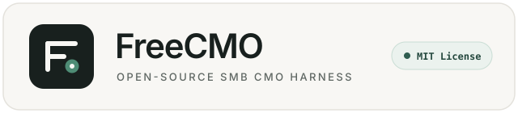

<div align="center">



<br />
<br />

**An attention-budgeted, deterministic AI Marketing Department for solo founders and lean SMBs.**

Works inside **Antigravity** · **Gemini CLI** · **Claude Code** · **OpenAI Codex** · **Cursor** · **Local Ollama**  
Zero external Python dependencies (`Python 3.11+` stdlib) · MIT Licensed

[Quick Start](#quick-start) &nbsp;·&nbsp; [User Journeys](#user-journeys) &nbsp;·&nbsp; [Architecture](#architecture) &nbsp;·&nbsp; [Built-In Safeguards](#built-in-safeguards) &nbsp;·&nbsp; [Skill Library](#17-skill-library)

</div>

---

Most AI marketing tools are noisy prompt dumps that invent metrics and bury you in 50-page docs. **FreeCMO** takes the opposite approach: calm, verifiable execution.

- **Math before opinions** — Computes allowable CAC, 3-month cash payback, blended MER, and statistical power in pure Python. Missing numbers stay `unknown`—never guessed.
- **Strategy before production** — Copy, ads, and code PRs stay hard-blocked until you review and lock `.agents/brand-truth.md`.
- **10 minutes a week** — Synthesizes cross-channel telemetry into **one batched Weekly Brief (max 5 ranked decisions)**, surfacing alerts only when tracking breaks or spend spikes.

---

## User Journeys

<div align="center">

</div>

<br />

<table>
<tr>
<td width="50%" valign="top">

### 01 · Day-1 Setup & Strategy Lock
`/cmo init`

Point FreeCMO at your site URL or repo with your budget and margins. It extracts `.agents/brand-truth.md` and `.agents/visual-dna.json`, calculates your **break-even ROAS** and **allowable CAC**, and checks launch readiness. Nothing ships until you change `status: locked`.

</td>
<td width="50%" valign="top">

### 02 · 10-Minute Weekly Monday Brief
`weekly-cmo-brief`

Drop ad & revenue CSVs into `data/exports/` (or connect read-only MCPs). FreeCMO reconciles storewide **blended MER** against platform ROAS, shifts dollars from weak cold ads to higher-ROI retention cohorts, retires disproven tests, and returns **≤5 P0/P1/P2 decisions** with receipts.

</td>
</tr>
<tr>
<td width="50%" valign="top">

### 03 · Instant Asset Amplification
`/cmo run-with-this <photo_or_note>`

Drop a product release note, customer win, or event photo. FreeCMO drafts coordinated LinkedIn, X, Reddit (with automatic FTC affiliation disclosure), email, and timed **`9:16` / `1:1` / `16:9` storyboards** (`0–4s` hook → `4–10s` proof → `10–15s` CTA). Only organic posts beating the 30-day median by `>=2x` graduate to `PAUSED` paid ads.

</td>
<td width="50%" valign="top">

### 04 · Waste Mining, GEO & Code PRs
`seo-geo-code-pr` · `geo_benchmark.py`

Clusters zero-conversion search terms into negative keywords (`ngram_waste.py`), suppresses paid search where organic ranks #1–2 (`<5%` competitor share), scores AI citations across **10 buyer prompts**, indexes Reddit/HN pain points in SQLite FTS5, and opens isolated git branches adding `FAQPage` JSON-LD, comparison tables, and AI `robots.txt`.

</td>
</tr>
</table>

### 05 · Permanent Taste Memory & 1-Click Rollback
- **Never repeat feedback twice (`instinct_extractor.py`):** Reject or edit a brief decision once (*"never use discount codes; first-person plural only"*) and FreeCMO distills it into `.agents/instincts.md` across every future channel.
- **1-Click Rollback (`/cmo rollback <action_id>`):** Every approved write requires a fresh (`<=60m`) Validator pass, latest Reviewer approval, and a single-use `approval_id` nonce, saving a pre-mutation snapshot to `data/rollbacks/`.

---

## Architecture

<div align="center">

</div>

<br />

Only the **Orchestrator** (`AGENTS.md` + `scripts/next_action.py`) reasons across channels. Individual specialist skills are stateless and blind to other channels, keeping active prompt context minimal (`<=16` active skills, payloads `>1,500` tokens offloaded to disk, static-to-dynamic KV-cache ordering).

---

## Built-In Safeguards

| SMB Failure Mode | Deterministic Code Defense |
|---|---|
| **Invented benchmarks & hallucinated ROI** | Calculators propagate `"unknown"` on missing inputs; Validator blocks unreceipted numbers. |
| **Burning cash on broken tracking or slow pages** | `budget_gate.py` locks paid scaling when `tracking_verified != true`, `site_load_sec >= 4.0`, or payback exceeds target. |
| **Silent ad-spend blowups** | Google Ads defaults to `validate_only=True`; Meta defaults to `PAUSED`; conditional stop-losses fire Circuit Breakers. |
| **Embarrassing VIP or investor outreach** | `.agents/guardrails.yaml` + `sanitizer.py` hard-block `vip_domains`, `vip_contacts_csv`, and protected segments. |
| **Zombie campaign ideas** | Breached `disproof_condition` tests move automatically to `Killed Assumptions` and cannot be re-pitched. |
| **Prompt injection & formula exploits** | `sanitizer.py` neutralizes `</untrusted_data>` breakouts; `csv_normalizer.py` neutralizes `=`, `+`, `-`, `@` cells; zero `eval()`. |

---

## Quick Start

### 1 · Clone & Verify Locally (Zero Dependencies)

```bash
git clone https://github.com/muvule/freecmo.git
cd freecmo

python3 scripts/build_packages.py --check
python3 scripts/validate_skills.py
python3 scripts/nightly_exam.py
python3 -m unittest discover -s tests -v
```

### 2 · Choose Your Operating Tier

| Tier | Setup | What You Get |
|---|---|---|
| **Tier 0 · Offline CSVs** | Drop CSVs into `data/exports/` | Pure Python unit economics, MER, n-gram waste, CDP cohorts, and Dual Readout briefs with zero API keys. |
| **Tier 1 · BYOK / Ollama** | `cp .env.example .env` | Connect OpenAI, Anthropic, Gemini, DeepSeek, or local Ollama (`127.0.0.1:11434`) for 10-prompt GEO benchmarks & agent workflows. |
| **Tier 2 · Read-Only MCPs** | `cp mcp_config.json.example mcp_config.json` | Lazy-load read-only GA4, Google Search Console, Meta Ads, PostHog, and Klaviyo connectors. |

### 3 · Run in Your Coding Harness

- **Antigravity / Gemini CLI** — reads `GEMINI.md` & `gemini-extension.json`
- **Claude Code / Cowork** — reads `CLAUDE.md` & `.claude-plugin/plugin.json`
- **OpenAI Codex / Cursor** — reads `AGENTS.md` & `.codex-plugin/plugin.json`

---

## 17-Skill Library

All 17 source skills in `skills/` compile into channel bundles (`packages/`) and a lean **16-skill runtime pack** in `.agents/skills/` (`cmo-init` serves as the one-time bootstrap command). Every skill includes missing-data rules, stage preconditions, spend/compliance flash points, primary platform docs, and live-recomputed `cmo-check` worked examples.

| Domain | Skills |
|---|---|
| **Core & Strategy** | `cmo-init` · `unit-economics-floors` · `weekly-cmo-brief` |
| **Analytics & Tracking** | `blended-mer-reconciler` · `tracking-health-audit` |
| **Paid Search** | `google-ads-smb-audit` · `search-term-negative-miner` |
| **Organic Search & GEO** | `gsc-query-drift-triage` · `local-seo-gbp-optimizer` · `aeo-entity-readiness` · `seo-geo-code-pr` |
| **Paid & Organic Social** | `meta-ads-smb-audit` · `ad-creative-angle-matrix` · `social-seo-repurposer` · `community-pain-radar` |
| **Lifecycle & CRO** | `landing-page-cro-audit` · `email-deliverability-flows` |

<details>
<summary><strong>Repository Structure</strong></summary>

```text
freecmo/
├── AGENTS.md / CLAUDE.md / GEMINI.md   # Cross-host orchestrator & governance contract
├── .agents/                            # Brand truth template, Visual DNA, instincts.md, guardrails.yaml, active skills (<=16)
├── assets/                             # Minimalist Scandinavian SVG logo & system diagrams
├── calculators/                        # Pure Python 3.11+ stdlib math engines (cac_ltv, mer, experiment_math, ngram_waste, budget_gate)
├── connectors/                         # CSV normalizer, SQLite CDP resolver, FTS5 radar, offloader, sanitizer, adapters, approval gate
├── schemas/                            # Draft 2020-12 JSON Schemas (subtask_spec, worker_output, storyboard, experiment, composers_brief)
├── skills/ & packages/                 # Source SKILL.md library and compiled channel packages
├── scripts/                            # next_action.py, geo_benchmark.py, instinct_extractor.py, validate_skills.py, build_packages.py, source_watch.py, nightly_exam.py
└── tests/                              # Stdlib unittest suite (22 unit & end-to-end tests)
```

</details>

---

<div align="center">

MIT License · [LICENSE](./LICENSE)

</div>
